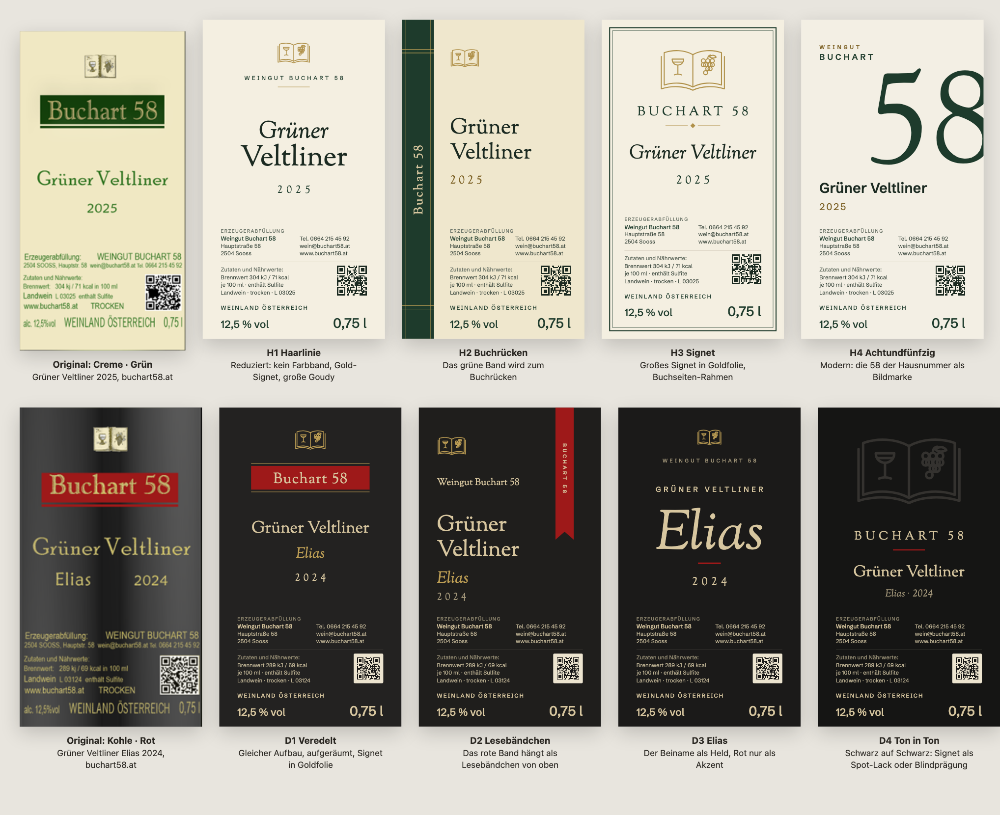

# Etiketten-Entwürfe Buchart 58

Stand 2026-11-12. Je vier Alternativen zu den beiden Etikett-Linien des Weinguts: **Hell** (Creme mit grünem Band, Weißweine) und **Dunkel** (Kohle mit rotem Band). Es sind Vorschläge zur Besprechung mit der Familie und mit Toni, der die Etiketten gestaltet, keine Druckdaten.

## Ordner

| Pfad | Inhalt |
|---|---|
| `original/` | Produktfotos von buchart58.at (heruntergeladen am 2026-11-12) und die daraus ausgeschnittenen Etiketten: Grüner Veltliner 2025 (hell), Grüner Veltliner Elias 2024 (dunkel) |
| `hell/`, `dunkel/` | Entwürfe als SVG im Druckmaß (mm, Schriften eingebettet) und als PNG-Vorschau |
| `uebersicht.png` | Originale und Entwürfe nebeneinander |
| `build.ts` | erzeugt alle Entwürfe neu: `bun _resources_/etiketten/build.ts` im Repo-Root (braucht `bun install` und den Playwright-Chromium) |

## Warum das dunkle Etikett hochwertig wirkt und das helle nicht

Das ist eine gestalterische Einschätzung, keine Messung. Beide Etiketten haben denselben Aufbau, der Unterschied liegt in Farbe und Gewichtung:

- **Farbe:** Gold auf Kohle erinnert an Folienprägung. Das gesättigte Grün auf gelblichem Creme wirkt dagegen wie Büropapier.
- **Band:** Auf Schwarz liest sich das rote Band als Siegel. Auf Creme wirkt das grüne Rechteck mit Unterstrich wie ein Stempel oder Textmarker.
- **Pflichtangaben:** Sie nehmen über ein Drittel der Fläche ein, in derselben Farbe und fast derselben Größe wie der Weinname. Auf Schwarz treten sie im gedämpften Gold zurück, auf Creme springt das Grün nach vorn. Es fehlt eine Rangordnung.
- **Schriften:** Drei bis vier Schriften (Goudy im Band, eine kalligrafische Antiqua für den Namen, eine schmale Grotesk für die Pflichtangaben), dazu gestauchte Laufweiten.
- **Signet:** Das Buch-Signet ist ein kleines farbiges Rasterbild und wirkt dadurch wie Clipart.

## Was alle Entwürfe gemeinsam haben

- **Zwei Schriften:** Sorts Mill Goudy für Marke und Wein (nah an der Goudy der heutigen Etiketten) und Schibsted Grotesk für die Pflichtangaben. Es ist dasselbe Paar wie in der Buch·Art-Familie des Section-Showcase, beide stehen unter der Open Font License.
- **Signet als Linienzeichnung,** dieselbe wie auf der Website (`section-showcase/src/sections/buchart-kit.tsx`). Gedacht für Goldfolie oder Prägung.
- **Hell:** ein weniger gelbes Elfenbein (`#f4efe1`) und ein tiefes Flaschengrün (`#1e3b2c`) statt Signalgrün. **Dunkel:** Kohle bis fast Schwarz, Gold `#d7c69f` und `#be9f55`, Rot `#9e1919` (Werte aus `section-showcase/src/sections/buchart-data.ts`).
- **Pflichtangaben vollständig wie auf den Originalen:** Erzeugerabfüllung mit Anschrift, Kontakt, QR-Code für Zutaten und Nährwerte, Brennwert je 100 ml, „enthält Sulfite“, Landwein, trocken, Los-Nummer, „Weinland Österreich“, Alkohol und Füllmenge. Alkohol, Füllmenge und Bezeichnung stehen gemeinsam unten in einem Sichtfeld.
- **Schriftgrößen nach den Mindestmaßen, soweit bekannt.** In der eingebetteten Schrift gemessen: x-Höhe der Pflichttexte 1,29 mm (Minimum 1,2 mm), Ziffern „12,5 % vol“ 3,29 mm (Minimum 3 mm bei 0,75 l), Ziffern „0,75 l“ 4,29 mm (Minimum 4 mm).
- **Keine neuen Herkunftsangaben.** „Thermenregion“ fehlt bewusst: Nach meinem Kenntnisstand darf ein Landwein nur die Weinbauregion („Weinland“) tragen, nicht das Weinbaugebiet.

## Hell (Creme · Grün)

| Entwurf | Idee | Warum es wirken soll | Risiko |
|---|---|---|---|
| **H1 Haarlinie** | Kein Farbband mehr. Signet in Gold, „Weingut Buchart 58“ gesperrt in Kapitälchen, großer zweizeiliger Weinname in Goudy. | Hochwertig durch Zurückhaltung und Raum, wie bei klassischen Gütern. Grün bleibt die Farbe der Linie, tritt aber als Schrift statt als Fläche auf. | Am weitesten vom heutigen Wiedererkennungsmerkmal (dem Band) entfernt. |
| **H2 Buchrücken** | Das grüne Band wird zum Buchrücken am linken Rand, mit Goldlinien wie die Bünde eines gebundenen Buchs und „Buchart 58“ längs gesetzt. | Nimmt das Wortspiel „Buch·Art“ beim Wort, und der Farbcode bleibt als große grüne Fläche erhalten. Auf der Flasche liegt der Rücken seitlich, die Vorderseite bleibt ruhig. | Der Rücken muss auf der runden Flasche sichtbar bleiben. Die Lage hängt davon ab, wie weit das Etikett um die Flasche reicht. |
| **H3 Signet** | Großes Signet in Goldfolie, doppelter Rahmen wie eine Buchseite, kursiver Weinname. | Das klassischste der vier, sehr nah an dem, was Kundinnen von einem Familienweingut erwarten. Die Folie macht den Unterschied zum Original. | Rahmen und Ornament können altmodisch wirken. Ohne echte Goldfolie verliert es viel. |
| **H4 Achtundfünfzig** | Die Hausnummer 58 als große Bildmarke, oben „Weingut Buchart“, der Weinname in der Grotesk. | Modern und eigenständig; zusammen gelesen ergibt sich die Wortmarke „Buchart 58“. Passt zu einer jüngeren Linie. | Bricht am stärksten mit der Tradition. Die angeschnittene 8 braucht genaue Platzierung beim Druck. |

## Dunkel (Kohle · Rot)

| Entwurf | Idee | Warum es wirken soll | Risiko |
|---|---|---|---|
| **D1 Veredelt** | Aufbau wie heute, aufgeräumt: rotes Band mit Goldlinien, Signet in Gold, „Elias“ kursiv in eigener Zeile, ruhiger Pflichtblock. | Der kleinste Schritt: Das heutige Etikett bleibt erkennbar, wirkt aber geordneter. | Wenig Neues, eher eine Überarbeitung als eine Alternative. |
| **D2 Lesebändchen** | Das rote Band hängt als Lesebändchen von der Oberkante, mit eingekerbtem Ende. | Dasselbe Bild wie auf der neuen Website (rotes Lesebändchen in der Buch·Art-Familie), dadurch Marke und Etikett aus einem Guss. | Das Bändchen muss beim Etikettieren an der Oberkante sauber sitzen. |
| **D3 Elias** | Der Beiname wird zum Hauptelement, groß und kursiv. Rot nur noch als kurzer Strich. | Macht die Linie persönlich; „Elias“ steht für einen Menschen aus der Familie, nicht für eine Sorte. | Passt nur für Weine mit Beinamen; Sortenweine brauchen eine Variante. |
| **D4 Ton in Ton** | Großes Signet schwarz auf schwarz, im Druck als Spot-Lack oder Blindprägung. Gold nur für Text. | Die edelste Wirkung, fällt erst im Licht auf. | Teurer im Druck. Die Vorschau zeigt den Effekt nur angedeutet. |

## Annahmen und offene Punkte

- **Format 80 × 140 mm** ist aus den Produktfotos geschätzt (Breite zu Höhe etwa 0,55). Das echte Maß kommt von der Druckerei. Alles ist Vektor und lässt sich umsetzen.
- **Kein Beschnitt.** Für den Druck braucht es meist 2 bis 3 mm Beschnitt rundum.
- **Der QR-Code ist ein Platzhalter** und führt auf buchart58.at. Der echte führt zur E-Label-Seite des jeweiligen Weins (siehe `Buchart58/OFFENE-FRAGEN.md`, Frage 1).
- **Schriften für den Druck in Pfade wandeln.** Die eingebetteten Schriften sorgen nur dafür, dass die SVGs in jedem Browser gleich aussehen. Grafikprogramme brauchen die Schriften installiert oder in Pfade umgewandelte Texte.
- **Goldfolie, Spot-Lack und Prägung** sind in den Vorschauen nur als Farbe angedeutet.
- **Rechtliches:** Die Mindestgrößen und die Regeln zu Herkunftsangaben sind mein Kenntnisstand, nicht geprüft. Vor dem Druck mit der Druckerei oder der WKO abgleichen.
- **Auf der 3D-Flasche ansehen:** Die PNGs lassen sich als `labelSrc` an `BottleStage` (`components/bottle-stage/`) geben. Das Format dort ist etwa 5:7, also breiter als diese Entwürfe; dafür bräuchte die Bühne ein anpassbares Etikettformat.
